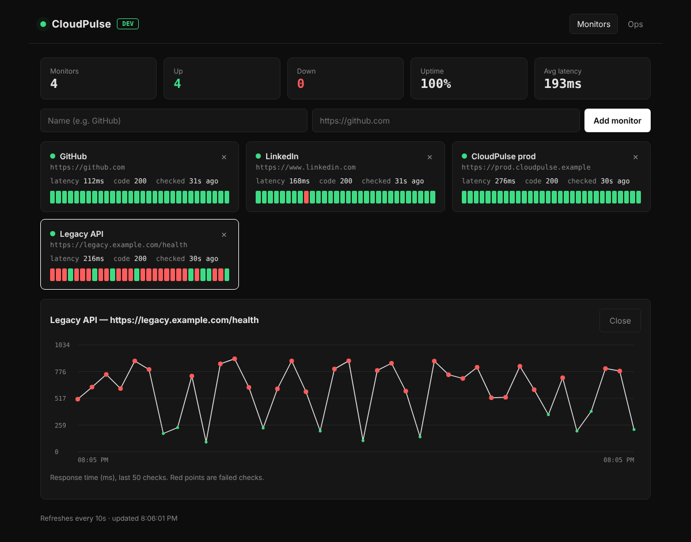
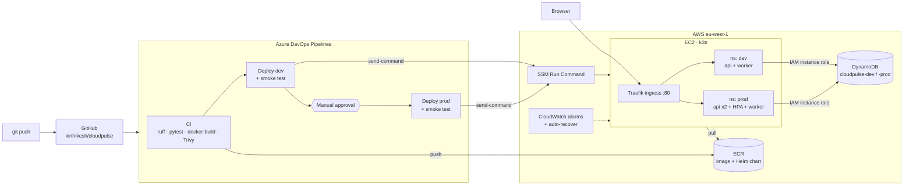

# CloudPulse

**Uptime monitoring platform on AWS, delivered by Azure DevOps.**
A FastAPI service with a vanilla JS dashboard, running on k3s on EC2, with DynamoDB for storage. Infrastructure is built with Terraform, and every deploy goes through AWS SSM: no SSH, no exposed Kubernetes API.




---

## What it does

Add any URL and CloudPulse checks it on an interval. It records status code and latency in DynamoDB and shows everything on a live dashboard:

- **Summary bar**: monitors, up/down, uptime %, average latency
- **Status cards**: last 30 checks per URL as an up/down strip
- **Latency chart**: hand-drawn on `<canvas>`, no chart library
- **Ops tab**: which build, image tag, git commit and pod served the page, so you can see what the pipeline shipped

## Architecture



## Highlights

| Area | What's in it |
|---|---|
| **CI/CD** | Azure DevOps multi-stage YAML. Lint, tests with published results, image build, Trivy gate, push to ECR, dev → smoke test → **approval** → prod. Dev and prod run the **same image and chart version**, so prod gets exactly what was tested. |
| **Deploys without SSH** | The pipeline finds the node by tag and runs `helm upgrade --atomic` on it through **SSM Run Command**. Port 22 and 6443 stay closed. A failed rollout rolls back automatically. |
| **Helm via OCI** | The chart is versioned per build (`1.0.<BuildId>`) and stored in ECR next to the image. |
| **Infrastructure as Code** | Terraform: VPC, EC2 (IMDSv2, encrypted gp3), EIP, ECR (immutable tags, scan on push, lifecycle), DynamoDB (TTL, PITR on prod), IAM, CloudWatch, SNS. Remote state in S3 with native locking. |
| **Infra pipeline** | `fmt` → `validate` → **Checkov** → `plan` (published as an artifact) → approval → `apply` of the saved plan. |
| **Least privilege** | The pipeline's IAM user can only push to two ECR repos and send SSM commands to one instance. Pods reach DynamoDB through the node role, so there are no keys in the cluster. |
| **Kubernetes hardening** | Pod Security `restricted` enforced on namespaces, non-root, read-only root filesystem, all capabilities dropped, NetworkPolicy, PDB, HPA in prod. |
| **Resilience** | Readiness checks DynamoDB, liveness checks the process. EC2 auto-recovers on host failure and reboots on OS check failure. CPU and CPU-credit alarms. |
| **Observability** | Prometheus `/metrics` (request counts, check results, latency histogram). Build metadata is shown in the dashboard. |

## Repo layout

```
app/                 FastAPI API + background checker + HTML/CSS/JS dashboard, tests, Dockerfile
deploy/helm/         Helm chart (api, worker, ingress, HPA, PDB, NetworkPolicy) + per-env values
deploy/scripts/      ssm-deploy.sh (runs on the ADO agent), smoke-test.sh
infra/bootstrap/     One-time S3 bucket for Terraform state
infra/aws/           All AWS infrastructure
pipelines/           app-pipeline.yml, infra-pipeline.yml (Azure DevOps)
docs/                Setup guide and screenshots
```

## Run it locally

```bash
cd app
docker compose up --build        # app + DynamoDB Local
open http://localhost:8000
```

Tests (DynamoDB is mocked with moto):

```bash
cd app
pip install -r requirements-dev.txt
pytest
```

## Deploy to AWS

Step-by-step guide: **[docs/SETUP.md](docs/SETUP.md)**. Short version:

1. `infra/bootstrap`: create the Terraform state bucket
2. `infra/aws`: `terraform apply` (VPC, EC2 + k3s, ECR, DynamoDB, IAM)
3. Azure DevOps: AWS service connection, `cloudpulse-dev` / `cloudpulse-prod` environments, pipeline from `pipelines/app-pipeline.yml`
4. Push to `main`, approve prod, open `http://prod.<ip>.nip.io`

## Cost

| Resource | Approx. (eu-west-1) |
|---|---|
| EC2 t3.small + detailed monitoring | ~$0.60/day |
| Public IPv4 (EIP) | ~$0.12/day |
| EBS gp3 20 GB | ~$0.06/day |
| DynamoDB on-demand, ECR, SSM, SNS | free tier / cents |

**≈ $0.80/day while running.** Run `terraform destroy` in `infra/aws` when you're not demoing. The state bucket stays, so the next `apply` rebuilds everything in about 5 minutes.

## API

| Method | Path | |
|---|---|---|
| GET | `/` | Dashboard |
| GET | `/api/monitors` | List monitors |
| POST | `/api/monitors` | `{"name": "...", "url": "https://..."}` |
| DELETE | `/api/monitors/{id}` | Remove a monitor and its history |
| GET | `/api/monitors/{id}/checks?limit=30` | Recent check results |
| GET | `/api/summary` | Totals, uptime %, average latency |
| GET | `/api/info` | Env, build, image tag, pod |
| GET | `/healthz` · `/readyz` · `/metrics` | Probes and Prometheus |

## Roadmap

- [ ] OIDC (workload identity federation) instead of access keys for the AWS service connection
- [ ] HTTPS with cert-manager and Let's Encrypt
- [ ] kube-prometheus-stack + Grafana dashboard for `cloudpulse_*` metrics
- [ ] Alert (SNS/email) when a monitored URL goes down
- [ ] Multi-node: move to EKS, or add k3s agents in an Auto Scaling group

---

Built by [Kirthikesh Parthasarathy](https://www.linkedin.com/in/kirthikeshparthasarathy/), DevOps Engineer, Dublin.
